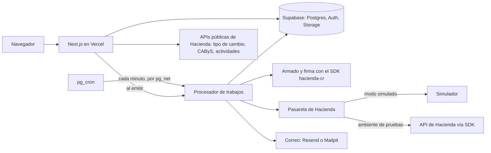

# Arquitectura

## Vista general



Todo lo que firma o habla con Hacienda corre en el servidor. El SDK pide Node 22 o superior y usa `node:crypto`, `Buffer` y WebAssembly; en Next.js 16 las rutas y las acciones del servidor corren en Node sin declararlo ([decisión 0001](decisiones/0001-nextjs-supabase-runtime-node.md)). El navegador nunca recibe la llave criptográfica ni el PIN.

## Carpetas

```
src/
  app/          pantallas y rutas de Next.js
  dominio/      reglas sin dependencias externas: montos, impuestos, clave, fechas y estados
  hacienda/     armado y firma del XML con el SDK, y la pasarela: interfaz, simulador e implementación con el SDK
  servidor/     acciones del servidor, procesador de trabajos, cifrado, correo y PDF
supabase/
  migrations/   esquema, políticas RLS y funciones
  tests/        pruebas de base de datos con pgTAP
  seed.sql      datos inventados para desarrollo
pruebas/        integración y recorridos con Playwright
```

`dominio/` no importa Next.js, Supabase ni el SDK. Se prueba con Vitest, sin red ni base de datos.

## Operaciones atómicas

El cliente de Supabase habla con Postgres por HTTP y no puede abrir una transacción y correr varias sentencias dentro. Por eso cada operación que tiene que ser atómica es una función de Postgres que el servidor llama por RPC: `emitir_comprobante`, `tomar_trabajos` y las que cierran o reprograman un trabajo. Los cálculos (montos, clave, fechas) se hacen en TypeScript, en `dominio/`; las funciones de la base solo guardan y cambian estados.

## Flujo de una factura

Estados: `borrador`, `en_cola`, `enviado`, `aceptado`, `rechazado` y `error`. Las transiciones permitidas están en `dominio/estados` y la base las vuelve a comprobar.

1. Borrador. La pantalla guarda cliente, líneas y montos. Un borrador se edita y se borra, y no tiene consecutivo.
2. Emitir. La acción del servidor valida los datos, recalcula los montos, toma el tipo de cambio del día y llama a `emitir_comprobante`. En una sola transacción, la función pasa el borrador a `en_cola` solo si sigue en `borrador`, reserva el consecutivo ([decisión 0006](decisiones/0006-consecutivos-en-la-base.md)), guarda la fecha de emisión, el código de seguridad y la copia de emisor, receptor, líneas y totales, y crea el trabajo `enviar`. Un segundo clic encuentra el comprobante ya emitido y no crea otro. Desde ese momento la base rechaza cualquier cambio a los datos del comprobante.
3. Trabajo `enviar`. Primero, si todavía no existe `clave.xml`, arma el XML con el SDK a partir de la copia guardada, lo valida contra el XSD, lo firma con la llave del emisor descifrada en memoria y lo guarda. Después hace el envío a Hacienda una vez. Si Hacienda lo recibe, el comprobante pasa a `enviado` y se crean los trabajos `entregar` y `consultar`. Qué se hace con cada otro resultado (duplicado, tiempo agotado, error del servidor, credenciales rechazadas) está en la [decisión 0007](decisiones/0007-emision-y-envio-idempotentes.md).
4. Trabajo `entregar`. Le manda al cliente el XML firmado y el PDF, aunque Hacienda todavía no haya respondido (artículo 18 del reglamento).
5. Trabajo `consultar`. Pide el estado con esperas cada vez más largas. Hacienda tiene tres horas para responder (artículo 11 de la resolución MH-DGT-RES-0027-2024); pasado ese plazo el trabajo sigue consultando una vez por hora durante un día. Cuando llega la respuesta, guarda `clave_respuesta.xml`, pasa el comprobante a `aceptado` o `rechazado` y crea `entregar_respuesta`.
6. Un comprobante rechazado no tiene validez. Se corrige y se emite uno nuevo que lo referencia con el código 16 de la nota 9 del Anexo, «Sustituye comprobante electrónico rechazado», sin nota de crédito (artículo 19 del reglamento).

La clave de 50 dígitos se calcula en `dominio/clave` con datos que ya están guardados: cédula del emisor, fecha, consecutivo, situación y código de seguridad. El trabajo `enviar` la escribe en la columna `clave` al armar el XML.

Si un trabajo agota sus reintentos, el comprobante pasa a `error` con el detalle, y desde la pantalla se puede reintentar con la misma clave y el mismo XML. Un consecutivo no se abandona ni se reutiliza. La cola está descrita en la [decisión 0004](decisiones/0004-cola-de-trabajos-en-postgres.md).

## Datos

- `emisores`: usuario dueño, tipo y número de identificación (únicos), nombre, correo, actividad económica, sucursal y terminal por defecto, y ambiente (`simulado` o `pruebas`). Las políticas RLS de todas las tablas filtran por el emisor del usuario.
- `credenciales_hacienda`: por emisor y ambiente, el usuario, la contraseña, la llave .p12 y el PIN, cifrados, y el vencimiento del certificado. No tiene políticas para usuarios: solo la lee el servidor.
- `clientes` y `servicios`. El servicio guarda su código CAByS y la descripción con que se eligió.
- `comprobantes`: tipo (09 exportación, 03 nota de crédito y, si se hace la última etapa, 01 factura), consecutivo, clave, situación, fecha de emisión, código de seguridad, moneda, tipo de cambio, totales, copia de emisor y receptor, referencia (para nota de crédito y reemisión), estado, rutas de los archivos y mensaje de Hacienda.
- `lineas_comprobante`: código CAByS, cantidad, unidad, precio, impuesto y montos de cada línea.
- `consecutivos`: emisor, ambiente, tipo, sucursal, terminal y último número usado.
- `trabajos`: tipo, comprobante, estado, intentos, próximo intento, hasta cuándo lo tiene tomado un procesador y último error.
- `eventos_comprobante`: bitácora de cada cambio de estado y de cada llamada a Hacienda que trae algo nuevo o falla.
- `entregas`: cada correo enviado: comprobante, tipo (comprobante o respuesta), destinatario, estado e identificador del proveedor.
- `tipos_cambio`: fecha, venta, compra y fuente (API de Hacienda o escrito a mano).

Los montos se guardan como `numeric(18,5)`, igual que en el Anexo: 13 enteros y 5 decimales. En el código pasan por el módulo de montos ([decisión 0003](decisiones/0003-montos-con-aritmetica-decimal.md)).

Los archivos van a un bucket privado de Supabase Storage, en `emisor/ambiente/año/mes/`, con los nombres que fija la nota 3 del Anexo: `clave.xml`, `clave_respuesta.xml` y `clave.pdf`. Se conservan cinco años (artículo 22 del reglamento) y se descargan con URLs firmadas de corta duración. El ZIP del mes se arma al pedirlo y se transmite por partes, porque una función de Vercel no puede responder más de 4,5 MB de una vez.

## Fechas

La fecha de emisión, la fecha dentro de la clave y el tipo de cambio «del día» usan la hora de Costa Rica (UTC-6, sin horario de verano). El servidor y pg_cron corren en UTC, así que entre las 6 de la tarde y la medianoche de Costa Rica ya es el día siguiente en UTC. `dominio/fechas` es el único lugar que hace esa conversión, y sus pruebas cubren ese tramo.

## Errores

- De validación. Los arregla la persona y se muestran junto al campo. Un mismo esquema de Zod valida en el formulario y en la acción del servidor.
- Del dominio. Una regla no se cumple, por ejemplo un monto fuera de rango. Las funciones de `dominio/` devuelven un resultado con el error tipado y no lanzan excepciones para casos esperados.
- Pasajeros de un servicio externo (Hacienda, correo, APIs públicas). El trabajo se reprograma con una espera más larga y la pantalla muestra «pendiente».
- Permanentes de un servicio externo, como credenciales rechazadas. El comprobante pasa a `error` con un mensaje que dice qué hacer.
- Inesperados. Se registran con su contexto y la persona ve un mensaje general.

El rechazo de Hacienda queda fuera de esta lista: es un resultado del comprobante, con su propio estado, y se muestra con su motivo.

Si la API de tipo de cambio, de CAByS o de actividades no responde, la persona puede escribir el dato a mano. El tipo de cambio escrito a mano queda marcado así.

## Seguridad

El [modelo de amenazas](seguridad.md) dice qué se protege, de quién y qué riesgo queda. Las medidas principales:

- RLS en todas las tablas, con pruebas pgTAP que comprueban que un usuario no ve los datos de otro emisor.
- Credenciales cifradas con AES-256-GCM y ligadas a su emisor ([decisión 0005](decisiones/0005-credenciales-cifradas.md)). La llave maestra está en una variable de entorno del servidor.
- La llave .p12 se descifra en memoria solo para firmar. No se escribe en disco y no aparece en los logs.
- El procesador de trabajos exige un secreto que pg_cron manda en un encabezado y que está guardado en Supabase Vault.
- En la nube solo entran la demo anónima y la cuenta del dueño ([decisión 0009](decisiones/0009-demo-anonima-y-registro-cerrado.md)). La demo no deja cargar credenciales ni manda correos.

## Qué pasó con un comprobante

La pantalla de detalle muestra la bitácora del comprobante: cuándo se emitió, se firmó, se envió, qué respondió Hacienda y qué correos salieron. Sale de `eventos_comprobante` y `entregas`. Los logs del servidor son JSON con el comprobante, el trabajo y el intento, y pasan por una función que oculta secretos. Una pantalla interna lista los trabajos pendientes, vencidos y fallidos. Un chequeo diario recorre la demo desplegada y avisa si falla ([decisión 0008](decisiones/0008-bitacora-en-la-base.md)).

## Accesibilidad

La meta es WCAG 2.2 AA en los recorridos principales. Cada pantalla se entrega con etiquetas en todos los campos, errores asociados a su campo, foco visible, recorrido completo con teclado y estados que no dependen solo del color. axe corre dentro de los recorridos de Playwright. El README dice qué se revisó; no declara conformidad.

## Pruebas

| Capa | Qué se prueba | Con qué |
| --- | --- | --- |
| Dominio | Montos, impuestos, clave, fechas y estados, con casos del Anexo y pruebas de propiedades (la suma de las líneas da el resumen; redondear dos veces no cambia el valor) | Vitest y fast-check |
| Armado y firma | XML de referencia por cada entrada fija, validación contra el XSD oficial, firma verificada con `verifySignedDocumentXml` y que el monto escrito en el XML sea igual al calculado | Vitest con el SDK y una llave .p12 de prueba generada en local |
| Pasarela | Un mismo juego de pruebas de contrato para el simulador y para la implementación con el SDK (esta, solo con credenciales) | Vitest |
| Base | RLS por tabla, credenciales sin acceso para usuarios, comprobante emitido que no se puede editar y `emitir_comprobante` llamado dos veces | pgTAP |
| Concurrencia | Veinte emisiones a la vez no repiten consecutivo ni dejan huecos; dos procesadores no toman el mismo trabajo | Integración con Supabase local (pgTAP corre en una sola sesión y no puede probarlo) |
| Trabajos | Cada rama de la decisión 0007 contra el simulador, y una caída entre la firma y el envío | Integración con Supabase local |
| Recorridos | Emitir en modo simulado, ver la factura aceptada, bajar los archivos y encontrar los correos en Mailpit; un rechazo y su reemisión; axe en cada pantalla | Playwright |
| Ambiente de pruebas | Un envío real | Workflow manual de GitHub Actions, cuando haya credenciales |

Que el simulador acepte un comprobante no prueba que Hacienda lo acepte. Lo que sí se comprueba sin credenciales es que el XML cumple el XSD que Hacienda publica y que la firma tiene la estructura correcta.

## Entornos

| Entorno | Base de datos | Hacienda | Correo |
| --- | --- | --- | --- |
| Local | `supabase start` con `seed.sql` | simulador, o ambiente de pruebas si hay credenciales | Mailpit de Supabase local |
| Nube | proyecto de Supabase | por emisor: simulador o ambiente de pruebas | Resend; en la demo, solo en pantalla |

Node 24 fijado en `engines`, npm, y la CLI de Supabase como dependencia de desarrollo para que local e integración continua usen la misma versión. El deploy a Vercel se hace por CLI, sin conexión automática con GitHub. Los secretos van en las variables de entorno de Vercel y ninguno se guarda en el repo.
